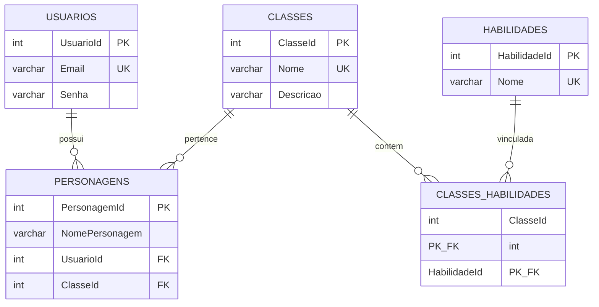

# Projeto de Banco de Dados: RPG Online

Este repositório contém a modelagem e a implementação física em SQL (DDL) do banco de dados para um sistema de jogo de RPG online, atendendo aos requisitos propostos na atividade avaliativa da disciplina de Banco de Dados.

O objetivo do projeto é estruturar as entidades, atributos, chaves primárias, chaves estrangeiras e relacionamentos necessários para suportar os dados de usuários, personagens, classes e habilidades do jogo.

---

## 📌 Modelo Conceitual e Lógico

A arquitetura do banco foi desenvolvida com base no diagrama da atividade, mapeando o seguinte fluxo de negócio:

1. **USUARIOS (1:N) PERSONAGENS**: Cada usuário pode criar múltiplos personagens, mas cada personagem pertence a uma única conta de usuário.
2. **CLASSES (1:N) PERSONAGENS**: Uma classe pode ser escolhida por vários personagens, enquanto cada personagem possui apenas uma classe ativa.
3. **CLASSES (N:N) HABILIDADES**: Uma classe pode conter diversas habilidades, e uma mesma habilidade pode ser compartilhada por diferentes classes. Esta relação de muitos-para-muitos foi resolvida por meio da tabela associativa `CLASSES_HABILIDADES`.

### Diagrama Entidade-Relacionamento

---

## 📋 Dicionário de Dados

Abaixo estão detalhadas as tabelas criadas e suas restrições de integridade:

### 1. `USUARIOS`
Armazena as contas de acesso dos jogadores ao sistema.

| Campo | Tipo | Restrições | Descrição |
| :--- | :--- | :--- | :--- |
| `UsuarioId` | `INT` | `PK`, `IDENTITY(1,1)` | Identificador exclusivo do usuário |
| `Email` | `VARCHAR(150)` | `NOT NULL`, `UNIQUE` | E-mail de login (não duplicável) |
| `Senha` | `VARCHAR(255)` | `NOT NULL` | Senha de autenticação |

### 2. `CLASSES`
Armazena as classes disponíveis para seleção no jogo (ex.: Guerreiro, Mago, Ladino, Clérigo).

| Campo | Tipo | Restrições | Descrição |
| :--- | :--- | :--- | :--- |
| `ClasseId` | `INT` | `PK`, `IDENTITY(1,1)` | Identificador exclusivo da classe |
| `Nome` | `VARCHAR(100)` | `NOT NULL`, `UNIQUE` | Nome da classe |
| `Descricao` | `VARCHAR(255)` | `NULL` | Descrição das características da classe |

### 3. `HABILIDADES`
Catálogo geral de magias, golpes e competências que podem ser aprendidas.

| Campo | Tipo | Restrições | Descrição |
| :--- | :--- | :--- | :--- |
| `HabilidadeId` | `INT` | `PK`, `IDENTITY(1,1)` | Identificador exclusivo da habilidade |
| `Nome` | `VARCHAR(100)` | `NOT NULL`, `UNIQUE` | Nome da habilidade |

### 4. `PERSONAGENS`
Armazena os personagens criados pelos jogadores dentro do jogo.

| Campo | Tipo | Restrições | Descrição |
| :--- | :--- | :--- | :--- |
| `PersonagemId` | `INT` | `PK`, `IDENTITY(1,1)` | Identificador exclusivo do personagem |
| `NomePersonagem` | `VARCHAR(100)` | `NOT NULL` | Nome do personagem |
| `UsuarioId` | `INT` | `NOT NULL`, `FK` | Chave estrangeira referenciando `USUARIOS(UsuarioId)` |
| `ClasseId` | `INT` | `NOT NULL`, `FK` | Chave estrangeira referenciando `CLASSES(ClasseId)` |

### 5. `CLASSES_HABILIDADES`
Tabela intermediária responsável por resolver a relação N:N entre Classes e Habilidades.

| Campo | Tipo | Restrições | Descrição |
| :--- | :--- | :--- | :--- |
| `ClasseId` | `INT` | `PK`, `FK` | Chave primária e estrangeira referenciando `CLASSES(ClasseId)` |
| `HabilidadeId` | `INT` | `PK`, `FK` | Chave primária e estrangeira referenciando `HABILIDADES(HabilidadeId)` |

---

## ⚙️ Regras de Integridade Aplicadas

- **Integridade de Entidade**: Implementada através de chaves primárias (`PRIMARY KEY`) em todas as tabelas, com autonumeração sequencial via `IDENTITY(1,1)`.
- **Integridade Referencial**: Assegurada por chaves estrangeiras (`FOREIGN KEY`) com validação de restrição (`CONSTRAINT`), impedindo que personagens fiquem órfãos ou apontem para classes/usuários inexistentes.
- **Unicidade e Obrigatoriedade**: Uso de `NOT NULL` para campos obrigatórios e `UNIQUE` para impedir duplicidade de cadastros sensíveis (como e-mails de usuários e nomes de classes/habilidades).
- **Chave Primária Composta**: Na tabela `CLASSES_HABILIDADES`, a chave primária é formada em conjunto por `(ClasseId, HabilidadeId)`, garantindo que uma mesma classe não receba a mesma habilidade mais de uma vez.

---

## 📂 Arquivos do Projeto

- `rpg_online.sql`: Script DDL completo contendo a criação do banco de dados, definição das tabelas, restrições, inserção de dados de teste e consultas de validação (`SELECT` com `JOIN`).
- `README.md`: Documentação técnica e descritiva do projeto.
